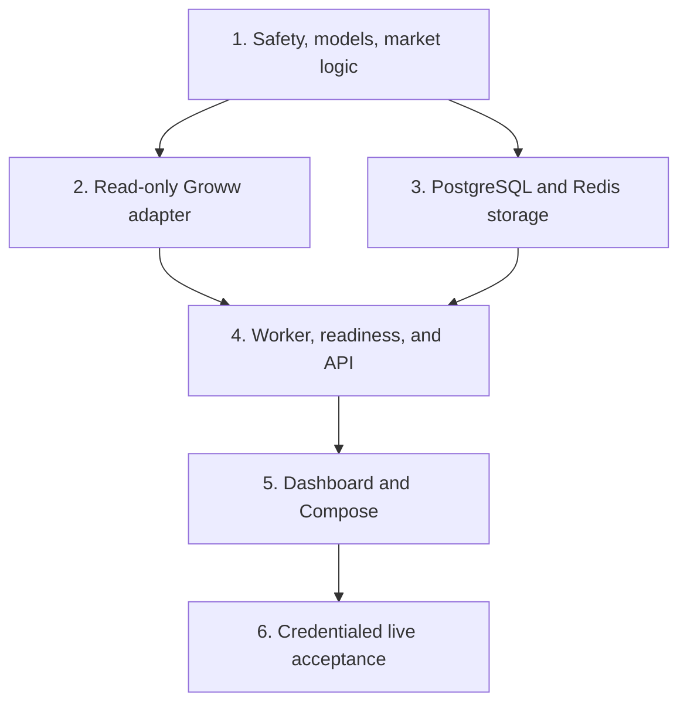

# Live Read-Only Foundation — Smallest Executable MVP Blueprint

**Status:** Adversarially reviewed; ready for execution  
**Created:** 2026-08-10  
**Source specification:** `docs/superpowers/specs/2026-08-03-live-read-only-foundation-design.md`  
**Earlier detailed plan:** `docs/superpowers/plans/2026-08-03-live-read-only-foundation.md`  
**Execution mode:** Direct local changes. Git is available on `main`; GitHub CLI is not installed.

## Objective

Prove, with the user's subscribed Groww account, that a localhost-only system can safely read and normalize current NIFTY and account state, consume the live feed, reconstruct auditable candles, persist durable history, expose only read APIs, and display honest operational state.

Completion requires real Groww responses. Missing credentials, subscription, Docker, calendar coverage, or feed data must produce `BLOCKED`, `STALE`, or `MARKET_CLOSED`; none may trigger fixture or simulated runtime data.

## Current Preconditions and Blockers

- The repository contains only the approved specification and an earlier implementation plan; there is no application code to preserve.
- `growwapi==1.5.0` is the current official PyPI release found during planning. Pin and report the installed version.
- The host has Python 3.14, Node 25, and pnpm 11. Groww's package metadata allows Python 3.9 through `<4`, but release containers target Python 3.12 and Node 24 for a narrower verified runtime.
- Docker and GitHub CLI are not installed. Steps requiring PostgreSQL, Redis, Compose, or PR automation remain unverified until those tools exist.
- Live acceptance additionally requires local TOTP credentials, an active Groww Trading API subscription, and an exchange-open observation window.

## Non-Negotiable Invariants

1. Application code contains no order placement, modification, cancellation, smart-order, GTT, OCO, or generic SDK passthrough.
2. Secrets stay in the worker process; they never enter Git, logs, PostgreSQL, Redis, API responses, or the browser.
3. Runtime values are live Groww values or an explicit operational failure state. Test fixtures cannot be imported by runtime modules.
4. PostgreSQL is durable history. Redis is replaceable current state.
5. Timestamps are stored as aware UTC values. Exchange decisions and display use `Asia/Kolkata`.
6. Instrument identity, expiry, strike ladder, lot size, tick size, and permissions come from the instrument master.
7. One-minute candles use event time and half-open buckets. Late events are audited without rewriting finalized candles. Five-minute candles aggregate finalized one-minute candles only.
8. Readiness requires successful account reconciliation and the first valid live feed update after startup.
9. FastAPI's generated OpenAPI schema contains only `GET`/`HEAD` operations and no execution-shaped route or schema.

## Deliberately Small Design

```text
Groww REST + Feed
        |
        v
read-only groww.py -> worker.py -> PostgreSQL events/candles
                            |----> Redis latest state/heartbeats
                                           |
                                           v
                                     FastAPI api.py
                                           |
                                      HTTP polling
                                           |
                                  one Next.js status page
```

- Keep one Python package with six focused modules: `config`, `models`, `market`, `groww`, `store`, `worker`, plus `api` as the entry point.
- Use one numbered SQL file mounted through PostgreSQL's native `/docker-entrypoint-initdb.d`; do not add an ORM or migration framework for a single initial schema. This supports only a fresh MVP volume; schema evolution after live data is a separate migration task.
- Use three tables: append-only `events` for instrument imports, snapshots, and feed observations; `candles`; and `health_transitions`.
- Use a checked-in, versioned NSE session file plus stdlib `zoneinfo`; unknown dates block readiness. Do not add a pandas-based calendar layer or a calendar scraper (the Groww SDK may still bring pandas transitively).
- Use a single Next.js page, CSS, and polling. Do not add a charting library, client state library, browser WebSocket/SSE, or component framework.
- Use pytest for backend, contract, integration, live, and static UI-safety checks. `next build` is the frontend runtime check; do not add a separate frontend test framework yet.

## External Contracts to Recheck During Implementation

- Groww authentication: <https://groww.in/trade-api/docs/python-sdk>
- Instruments: <https://groww.in/trade-api/docs/python-sdk/instruments>
- Quotes, option chain, and Greeks: <https://groww.in/trade-api/docs/python-sdk/live-data>
- Streaming feed: <https://groww.in/trade-api/docs/python-sdk/feed>
- Positions: <https://groww.in/trade-api/docs/python-sdk/portfolio>
- Orders and fills: <https://groww.in/trade-api/docs/python-sdk/orders>

If installed SDK signatures or real secret-free response shapes differ, stop with `GROWW_CONTRACT_MISMATCH`; do not infer mappings.

### Verified `growwapi==1.5.0` compatibility hazards

- The wheel writes feed JWT/NKey material to `growwapi/common/a.creds` and `b.creds`. The worker must version-gate and redirect those writes to a worker-only tmpfs with restrictive permissions, then remove them at shutdown.
- `get_order_list(page, page_size, segment=None)` sends no pagination parameters when `segment` is absent and ignores `page_size` even when a segment is present. Reconciliation must paginate `CASH`, `FNO`, and `COMMODITY` separately with an effective page size of 25 and detect repeated pages.
- The option-chain REST response has no bid/ask fields. Best bid/ask/spread must come from the feed's market-depth subscription; missing book sides remain `None`.

## Dependency Graph



Steps 2 and 3 may run in parallel after Step 1 because they own disjoint files. All other steps are serial. Do not parallelize work that edits shared models or Compose configuration.

---

## Step 1 — Safety Boundary and Deterministic Market Core

**Tier:** Strongest available model  
**Depends on:** Nothing  
**Suggested commit:** `build: establish read-only market core`

### Cold-start context

This is an empty Python/Next repository. Establish the contracts every later step consumes without contacting Groww or infrastructure. Preserve all invariants above. The source specification is authoritative when this brief is silent.

### Inputs and contracts

- Input: the approved specification at `docs/superpowers/specs/2026-08-03-live-read-only-foundation-design.md`; no prior code artifact exists.
- Runtime boundary: Python `>=3.11,<3.15`; the release image is Python 3.12. Host bootstrap may use the installed compatible interpreter, but Step 5 must rerun tests in the 3.12 image.
- Fixed thresholds: feed 10 seconds, quote 15 seconds, account 60 seconds, dependency timeout 2 seconds, option window 5 strikes each side.
- Output required by Steps 2/3: importable `trading_system.config`, `models`, and `market`, plus a passing unit suite and a pinned lock.

### Files

- Extend `.gitignore`; create `.env.example`.
- Create `apps/backend/pyproject.toml` and a pinned `requirements.lock` for FastAPI, Pydantic settings, `growwapi==1.5.0`, `pyotp`, psycopg, redis-py, uvicorn, pytest, and httpx only.
- Create `scripts/bootstrap.ps1` to select an installed compatible Python, create `.venv`, install the lock, and install the backend package editable with `--no-deps`.
- Create `apps/backend/src/trading_system/{__init__,config,models,market}.py`.
- Create `apps/backend/config/nse_sessions_2026.json` from an authoritative exchange calendar with a declared coverage end date.
- Create focused tests under `apps/backend/tests/unit/`.

### Tasks

1. Generate the lock once from the declared dependencies. `bootstrap.ps1` must fail clearly when no compatible Python is installed; it must not silently install runtimes or packages outside `.venv`.
2. Add secret-typed TOTP, PostgreSQL, and Redis settings. Defaults bind API/frontend to localhost. `safe_view()` exposes booleans and non-secret endpoints only.
3. Define immutable normalized models only for the specified NIFTY, option-chain, account, observation, candle, health, and API fields.
4. Resolve NIFTY spot, nearest eligible future, nearest option expiry, ATM, and ATM ±5 from instrument-master values; never hard-code a strike interval or lot size.
5. Implement session lookup, one-minute candle construction, five-minute aggregation, late/duplicate handling, and global status precedence as pure functions with injected time. Preserve the specified 10-second feed, 15-second quote, 60-second account, and 2-second dependency thresholds as settings.
6. Write the smallest tests that cover secret redaction, expiry/ATM selection, UTC bucket boundaries, late events, five-minute provenance, calendar-unknown blocking, and `BLOCKED > STALE > DEGRADED > MARKET_CLOSED > LIVE`.

### Verification

```powershell
scripts\bootstrap.ps1
.venv\Scripts\python.exe -m pytest apps/backend/tests/unit -q
.venv\Scripts\python.exe -m compileall -q apps/backend/src
git diff --check
```

### Exit criteria

- All pure tests pass without Groww, PostgreSQL, Redis, Node, or Docker.
- Rendering settings or errors does not reveal literal test secrets.
- An uncovered exchange date is `BLOCKED`, never inferred from weekdays.

### Rollback

Revert this step's files. It creates no external or durable state.

---

## Step 2 — Explicit Read-Only Groww Adapter

**Tier:** Strongest available model  
**Depends on:** Step 1  
**Parallel with:** Step 3  
**Suggested commit:** `feat: add read-only Groww adapter`

### Cold-start context

Build the sole broker boundary. Official contracts verified during planning include TOTP authentication, `get_all_instruments`, `get_quote`, `get_option_chain`, `get_available_margin_details`, `get_positions_for_user`, `get_order_list`, `get_trade_list_for_order`, `subscribe_index_value`, and `subscribe_ltp`. The SDK also exposes trading methods; application code must make them unreachable.

### Inputs and contracts

- Prerequisite check: `trading_system.config`, `models`, and `market` import from the Step 1 commit and `apps/backend/tests/unit` passes.
- REST boundary: `instruments()`, `market_snapshot()`, `account_snapshot()`, and `orders_and_fills()` only.
- Feed boundary: explicit subscribe/get/unsubscribe operations for index value, LTP, and market depth, plus blocking `consume()`; no raw SDK/client property.
- TOTP call: `GrowwAPI.get_access_token(api_key=<token>, totp=pyotp.TOTP(<secret>).now())`.
- Pagination: zero-based pages per `CASH`, `FNO`, and `COMMODITY`; 25 orders per effective page; per-order fills start at page zero with 50 rows per page and the originating order's segment. Both loops stop only on a short page and fail on a repeated full page.
- Failure semantics: missing config/entitlement/authentication is `BLOCKED`; timeout/rate-limit recovery may be `DEGRADED`; repeated/malformed response shapes are `GROWW_CONTRACT_MISMATCH`.

### Files

- Create `apps/backend/src/trading_system/groww.py`.
- Create secret-free documented payload fixtures under `apps/backend/tests/contract/fixtures/`.
- Create `apps/backend/tests/contract/test_groww_contract.py` and `apps/backend/tests/unit/test_groww_read_only.py`.

### Tasks

1. Authenticate in memory with the exact TOTP call above and construct the SDK client without logging either value. TOTP fields are optional in common settings and are required only by the worker entry point.
2. Add a version-gated `growwapi==1.5.0` feed compatibility shim in `groww.py`: redirect `growwapi.common.files.get_cwd()` to a configured worker-only directory, require that directory to be private, create feed credential files with `umask 077`, and delete `a.creds`/`b.creds` in `finally`. Fail closed for an unreviewed SDK version.
3. Expose only the REST and feed operations listed above; do not expose the SDK object, `__getattr__`, a generic call method, or private `_nats_client` access.
4. Normalize documented fields, preserving optional absence as `None`. Use option-chain data for LTP/OI/volume/Greeks and market-depth feed data for best bid, best ask, and spread; never synthesize a missing side. Map authentication, entitlement, rate-limit, timeout, and contract-shape failures to stable safe codes with correlation IDs.
5. Query orders separately for `CASH`, `FNO`, and `COMMODITY`, incrementing `page` from zero. Stop only on fewer than 25 rows. Deduplicate by `groww_order_id`; if a full page adds no new ID, fail `GROWW_CONTRACT_MISMATCH`. For every order, fetch fills from page zero using its segment and `page_size=50`; stop only on fewer than 50 rows, deduplicate by Groww/exchange trade ID, and fail if a full page adds no new trade ID.
6. Test documented fixture shapes, more than 25 orders, more than 50 fills, repeated full order/fill pages, malformed required fields, secret-safe failures, feed credential redirection/cleanup, runtime modules not opening fixtures, and absence of forbidden public methods.

### Verification

```powershell
.venv\Scripts\python.exe -m pytest apps/backend/tests/contract apps/backend/tests/unit/test_groww_read_only.py -q
git grep -n -E "place_order|modify_order|cancel_order|create_smart_order|__getattr__|_nats_client" -- apps/backend/src
```

The grep must return no application match.

### Exit criteria

- Contract and safety tests pass with no credentials.
- With valid local credentials, a manual one-shot read either returns normalized live data or a stable `BLOCKED` reason; it never returns fixtures.
- Feed credential files are redirected from the installed package and removed after wrapper shutdown in the focused test.

### Rollback

Remove the adapter and its tests. No database schema or external state is changed.

---

## Step 3 — Minimal Durable and Live Storage

**Tier:** Default model  
**Depends on:** Step 1  
**Parallel with:** Step 2  
**Suggested commit:** `feat: persist market events and live state`

### Cold-start context

PostgreSQL must retain enough source and normalized data to reproduce displayed candles and account/market snapshots. Redis holds only rebuildable latest state and heartbeats. There is no production database yet, so use the native PostgreSQL initialization mechanism instead of introducing migration machinery.

### Inputs and contracts

- Prerequisite check: Step 1 models import and unit tests pass; this step does not read or edit `groww.py`.
- PostgreSQL tables: `events`, `candles`, and `health_transitions`; every source event has `kind`, source/idempotency key, event/receive timestamps, raw JSONB, normalized JSONB, and late flag.
- Redis keys: `trading-system:v1:quote:<instrument>` (1 hour), `option-chain` (1 hour), `candle:<instrument>:<interval>` (10 minutes), `heartbeat:<subsystem>` (30 seconds), `account` (5 minutes), and `subscription` (30 seconds). Freshness is decided from source timestamps, not TTL alone.
- Output required by Step 4: `Store` operations to append/read events, upsert/read candles, record health transitions, set/get live values, and `rebuild_live_state()`.
- Failure semantics: connectivity timeout is `BLOCKED`; duplicate keys are successful no-ops; Redis loss is recoverable only from PostgreSQL plus fresh broker reads.

### Files

- Create `apps/backend/migrations/001_initial.sql`.
- Create `apps/backend/src/trading_system/store.py`.
- Create `apps/backend/tests/integration/test_store.py`.
- Create an initial `compose.yaml` containing private `postgres` and `redis` services only; Step 5 extends it.

### Tasks

1. Define `events`, `candles`, and `health_transitions`; use JSONB for raw/normalized event bodies and uniqueness keys for idempotency. Keep candle OHLC fields typed and unique by instrument, interval, bucket, and source.
2. Implement direct psycopg writes/reads and Redis JSON keys under `trading-system:v1:`. Do not add repository interfaces or an ORM.
3. Persist instrument imports, broker snapshots, normalized observations, feed events, account snapshots, and late-event flags as event kinds.
4. Rebuild Redis latest state from PostgreSQL after Redis loss; never rebuild credentials or SDK clients.
5. Test duplicate writes, late audit retention, UTC timestamps, Redis loss/rebuild, and absence of secrets.

### Verification

```powershell
docker compose up -d postgres redis
.venv\Scripts\python.exe -m pytest apps/backend/tests/integration/test_store.py -q -m integration
docker compose down
```

### Exit criteria

- The integration test passes against real PostgreSQL and Redis.
- Replaying the same event does not duplicate history or candles.
- Clearing Redis and rebuilding preserves durable history.
- If Docker remains unavailable, this step stays blocked; a skipped test is not completion.

### Rollback

Before real data exists, remove the disposable local volume and revert the SQL/code. After live data exists, never run `docker compose down -v`; stop services and roll application code back only. This MVP has no post-initialization schema evolution—design the first additive migration mechanism before changing the live schema.

---

## Step 4 — Feed Worker, Honest Readiness, and GET-Only API

**Tier:** Strongest available model  
**Depends on:** Steps 2 and 3  
**Suggested commit:** `feat: stream Groww data through read-only API`

### Cold-start context

Join the tested broker and storage boundaries. Groww feed consumption is blocking and belongs in a separate worker process. The API reads normalized PostgreSQL/Redis state and never receives Groww credentials or an SDK client.

### Inputs and contracts

- Prerequisite check: Steps 2 and 3 tests pass; `GrowwReadClient`/feed wrapper and `Store` are importable; PostgreSQL/Redis are healthy.
- Exact endpoints: `GET /health/live`, `/health/ready`, `/api/v1/system/status`, `/api/v1/market/nifty`, `/api/v1/market/nifty/options`, `/api/v1/market/nifty/candles?interval=1m|5m`, `/api/v1/account/summary`, and `/api/v1/account/orders`.
- Every market/account response contains `source` and source timestamp; safe errors contain code, reason, subsystem, correlation ID, and last-success timestamp.
- Feed fields: index `value`, derivative `ltp`, market depth `buyBook`/`sellBook`, and `tsInMillis`; callback `meta` identifies exchange, segment, feed type, and exchange token.
- Refresh: account reconciliation no slower than every 60 seconds; option OI/volume/Greeks every 60 seconds; instrument master at session start and expiry invalidation; ATM recomputed from live index values.
- Readiness: stores healthy + exhaustive segmented account reconciliation + subscriptions active + first valid live event. Missing optional depth side is `DEGRADED`, not fabricated.

### Files

- Create `apps/backend/src/trading_system/worker.py` and `apps/backend/src/trading_system/api.py`.
- Create `apps/backend/tests/unit/test_worker.py`, `test_readiness.py`, and `test_api.py`.
- Create `apps/backend/tests/unit/test_openapi_read_only.py`.

### Tasks

1. Execute startup in order: validate worker secrets; connect stores; authenticate; import instruments; exhaustively reconcile margin, positions, segmented orders/fills; persist snapshots; subscribe; wait for first valid feed event.
2. Subscribe with `subscribe_index_value`, `subscribe_ltp`, and `subscribe_market_depth`. In each callback, use `meta` to read only the changed instrument from `get_index_value`, `get_ltp`, or `get_market_depth`. Derive best bid as the maximum buy price, best ask as the minimum sell price, and spread as ask minus bid; preserve `None` when either side is absent.
3. Normalize `tsInMillis`, persist observations, update Redis, build candles, and refresh heartbeats. Treat feed volume as unavailable unless a trustworthy cumulative-volume field actually arrives.
4. Run a stdlib worker refresh loop: reconcile account state and refresh option OI/volume/Greeks every 60 seconds; refresh the instrument master at session start or expiry invalidation; recompute ATM from live index values. Persist every source snapshot and recovery transition.
5. When ATM or expiry changes, subscribe the new LTP/depth set successfully, switch Redis subscription state, then unsubscribe the old set. If the new subscription fails, retain the old set and report `DEGRADED`/`BLOCKED` as appropriate.
6. Use bounded exponential backoff with jitter for safe reads/reconnects. Authentication/entitlement failures are `BLOCKED`; callback silence during an open session becomes `STALE`.
7. On shutdown, call only public unsubscribe methods, remove the redirected feed credential files in `finally`, and terminate the worker process; never call private `_nats_client` methods.
8. Expose the exact endpoint allowlist above plus generated OpenAPI. Return 503 and a safe structured reason when required live state is unavailable. Allow browser origins only from localhost.
9. Test with a fake clock: readiness ordering, exhaustive pagination as a prerequisite, duplicate callbacks, nested depth payloads, missing book sides, late events, 60-second refresh/recovery, ATM subscription diff, expiry rollover, reconnect/shutdown cleanup, market-closed behavior, API redaction, and OpenAPI allowlists.

### Verification

```powershell
.venv\Scripts\python.exe -m pytest apps/backend/tests/unit apps/backend/tests/contract -q
.venv\Scripts\python.exe -c "from trading_system.api import app; import json; print(json.dumps(app.openapi()))" > openapi.tmp.json
git grep -n -E "place_order|modify_order|cancel_order|create_smart_order|_nats_client" -- apps/backend/src
Remove-Item -LiteralPath openapi.tmp.json
```

### Exit criteria

- Unit/contract tests pass and the forbidden-call grep has no application match.
- Readiness remains false before both reconciliation and first live feed data.
- OpenAPI contains only `GET`/`HEAD` operations and no execution-shaped schema.
- Account and option snapshots recover before their 60-second limit; an injected missed refresh becomes `STALE` rather than frozen `LIVE`.

### Rollback

Stop the worker/API and revert their files. Persisted append-only events remain valid and may be retained.

---

## Step 5 — One-Page Dashboard and Full Local Topology

**Tier:** Default model  
**Depends on:** Step 4  
**Suggested commit:** `feat: add localhost operations dashboard`

### Cold-start context

The dashboard is operational proof, not a trading terminal. It must make blocked/stale state visually dominant and must contain no execution control. Keep the browser unaware of Groww concepts beyond normalized API fields.

### Inputs and contracts

- Prerequisite check: Step 4 tests pass and its eight GET endpoints return normalized live state or explicit safe failure state.
- Browser allowlist: GET only the six `/api/v1/...` resources plus `/health/ready`; `GET /api/v1/account/orders` is required and is the only browser order path.
- Polling: system/market/options/candles every 3 seconds; account summary and current-day orders/fills every 15 seconds.
- Compose services: exactly `frontend`, `api`, `worker`, `postgres`, and `redis`. Only `127.0.0.1:3000` and `127.0.0.1:8000` are published.
- Environment boundary: `worker` receives named Groww + store variables; `api` receives named store/API/CORS variables only; `frontend` receives the localhost API URL only. No service uses a broad shared `env_file`.
- Feed secret boundary: worker runs non-root with `umask 077` and a private tmpfs mounted at the configured feed-credential directory.

### Files

- Create the minimal Next.js files under `apps/frontend/`: `package.json`, lockfile, `tsconfig.json`, `next.config.ts`, `src/app/layout.tsx`, `page.tsx`, and `globals.css`.
- Extend `compose.yaml` to exactly `frontend`, `api`, `worker`, `postgres`, and `redis`.
- Create `.dockerignore`, `compose.test.yaml`, minimal backend/frontend Dockerfiles with explicit `COPY` allowlists, and `README.md`.
- Add one static UI/API safety test to the backend test suite.
- Add one dependency-free Node test that renders the status banner with React's installed server renderer.

### Tasks

1. Generate and commit the pnpm lock once, then render the global state, service health, NIFTY spot/future, ATM ±5 option table, recent 1m/5m candles, margin/positions, and current-day orders/fills on one responsive page.
2. Poll system/market data every 3 seconds and account data every 15 seconds. Show source timestamps and safe reasons. Use an em dash for unavailable optional fields.
3. Use CSS only for layout and compact candle display. Preserve accessible headings, tables, focus behavior, and status text in addition to color.
4. Bind API/frontend ports to `127.0.0.1`. Do not publish PostgreSQL or Redis. Pass explicit named variables per the environment boundary; never give `api` or `frontend` a `GROWW_*` variable.
5. Give the backend Dockerfile a Python 3.12 `test` stage that contains source/tests and runs as non-root, plus a separate final runtime stage whose allowlist excludes tests and fixtures. `compose.test.yaml` adds one transient `backend-test` service built from that test stage and connected only to the base PostgreSQL/Redis services; production `compose.yaml` remains exactly five services.
6. Run the worker runtime stage as a fixed non-root UID with a `tmpfs` at `/run/groww-feed` using mode `0700`; configure the adapter shim to write there. Runtime image allowlists exclude `.env`, tests, fixtures, artifacts, Git data, and plans.
7. Allow frontend reads of `GET /api/v1/account/orders`, but reject every `POST`/`PUT`/`PATCH`/`DELETE`, execution path, execution control label, and credential name. Add a Node-native render test proving `BLOCKED`/`STALE`, source timestamp, and safe reason remain visible.
8. Build both runtime images and inspect their file lists and API container environment: neither image contains `.env`, fixtures, tests, or artifacts, and API contains no `GROWW_*` variable.

### Verification

```powershell
pnpm --dir apps/frontend install --lockfile-only
pnpm --dir apps/frontend install --frozen-lockfile
node --experimental-strip-types --test apps/frontend/src/tests/status.test.ts
pnpm --dir apps/frontend build
.venv\Scripts\python.exe -m pytest apps/backend/tests/unit/test_openapi_read_only.py apps/backend/tests/unit/test_ui_safety.py -q
docker compose config --quiet
docker compose up -d --build
docker compose ps
docker compose -f compose.yaml -f compose.test.yaml run --rm backend-test
docker compose exec api sh -lc "if env | cut -d= -f1 | grep '^GROWW_'; then exit 1; fi"
docker compose exec api sh -lc "find /app -type f"
docker compose exec worker sh -lc "stat -c '%a %u:%g %n' /run/groww-feed"
```

### Exit criteria

- The production frontend build succeeds.
- Compose has exactly five services and only localhost web ports.
- With credentials absent, the page visibly reports `BLOCKED`; it never shows sample market/account values.
- There is no buy, sell, approve, exit, execute, or order-ticket control.
- Runtime images contain no fixtures or `.env`; API has no `GROWW_*` environment entry; worker feed tmpfs is private.
- Unit, contract, and PostgreSQL/Redis integration suites pass inside the Python 3.12 backend test stage.

### Rollback

Stop Compose and revert frontend/topology files. PostgreSQL volumes remain untouched.

---

## Step 6 — Credentialed Live Acceptance and Evidence

**Tier:** Strongest available model  
**Depends on:** Step 5 and user preconditions  
**Suggested commit:** `test: prove live read-only Groww foundation`

### Cold-start context

This is the release gate. Fixtures prove parsing only; they cannot prove the product. Run with local TOTP credentials and an active subscription. Some feed/candle assertions require the regular exchange session.

### Inputs and contracts

- Prerequisite check: Step 5 builds both runtime images, all five services start, runtime images contain no fixtures/secrets, API has no `GROWW_*` environment name, and the worker tmpfs is private.
- Required user inputs: active Groww Trading API subscription and local TOTP token/secret; never accept them in chat or command-line arguments.
- Pass: observed real response/feed behavior matches persisted/API/UI state within timestamp tolerance. Pending: only a market-hours observation unavailable because the exchange is closed. Fail: any mismatch, stale/frozen `LIVE`, leaked secret, fixture/runtime coupling, pagination repeat, or execution surface.
- Evidence allowlist: SDK/app versions, timestamps, instrument IDs, row/event counts, state transitions, and pass/fail/pending reasons. Full account values, payloads, credentials, feed credential files, and environment dumps are forbidden.

### Files

- Create `apps/backend/tests/live/test_live_foundation.py`.
- Create `scripts/live-acceptance.ps1` and `docs/operations/live-acceptance.md`.
- Write runtime evidence only to ignored `artifacts/live-acceptance/latest.json`.

### Tasks

1. Verify live authentication, instrument resolution, NIFTY spot/future, ATM ±5 option window, margin, positions, current-day orders, and fills against direct Groww reads within timestamp tolerance.
2. During an open session, collect at least one complete minute, independently recompute OHLC from stored observations, and compare it with stored 1m and derived 5m candles when five minutes are available.
3. Stop the feed during an open session and verify `STALE`; restart and verify reconciliation occurs before readiness. Outside market hours, record `MARKET_CLOSED` and leave feed-only proof pending.
4. Fetch the running OpenAPI schema and repeat the mutation/execution allowlist. Scan loaded runtime paths to prove fixtures were not imported.
5. While the worker runs, verify `a.creds`/`b.creds` exist only in `/run/groww-feed` with private ownership/mode and nowhere in the image/package path. After worker shutdown, verify both files are gone. Use public unsubscribe plus process termination; do not inspect or invoke `_nats_client`.
6. Verify both runtime images contain no `.env`, tests, contract fixtures, or artifacts, and that the API environment has no `GROWW_*` variable name. Confirm blocked startup exposes no sample value.
7. Produce a redacted report containing versions, timestamps, instrument identifiers, counts, state transitions, and pass/fail/pending results only.

### Verification

```powershell
.venv\Scripts\python.exe -m pytest apps/backend/tests/unit apps/backend/tests/contract -q
.venv\Scripts\python.exe -m pytest apps/backend/tests/integration -q -m integration
pnpm --dir apps/frontend build
docker compose config --quiet
docker compose up -d postgres redis
docker compose -f compose.yaml -f compose.test.yaml run --rm backend-test
scripts/live-acceptance.ps1
git diff --check
git status --short
```

### Exit criteria

- All unit, contract, integration, frontend-build, Compose, and live-read checks pass.
- Market-hours feed/candle checks pass, or the release remains explicitly pending that observation.
- The report, logs, Git-tracked files, API, Redis, and PostgreSQL contain no secret.
- No execution-capable method or route exists.
- Feed credential material is tmpfs-only, privately permissioned while needed, and absent after worker shutdown.

### Rollback

Acceptance adds tests, documentation, and an ignored report only. Remove the report if it contains unexpected sensitive data; keep failed test evidence and fix the product rather than weakening the gate.

## Plan Mutation Protocol

- Record any split, insertion, reorder, skip, or abandonment in a dated `Change log` entry below before implementation continues.
- Never mutate away a non-negotiable invariant or convert a blocker into a passing fixture-backed mode.
- A step may split when it no longer fits one independently reviewable change. A step may merge only if verification and rollback stay independent.
- If an external Groww contract differs from the pinned SDK, stop the affected step as `BLOCKED`, update the contract fixture from a secret-free real shape, and review the adapter mapping explicitly.
- Independent work may continue around Docker, credentials, or market-hours blockers, but no blocked step may be marked complete.

## Anti-Patterns Rejected by This Plan

- Generic broker repositories, plugin systems, event buses, or interfaces with one implementation.
- ORM/Alembic for one initial local schema.
- Runtime fixture fallback, mock broker mode, or frozen prices presented as live.
- Frontend WebSocket/SSE, charting, design-system, global-state, or testing libraries before polling/build checks prove insufficient.
- TimescaleDB, Kubernetes, cloud deployment, remote auth, AI review, indicators, backtesting, or any execution feature.
- Saving full account payloads or credentials in evidence artifacts.

## Change Log

- 2026-08-10: Initial six-step MVP draft derived from the approved specification and reduced from the earlier ten-task plan.
- 2026-08-10: Adversarial review fixed SDK feed-credential persistence, segmented order/fill pagination, market-depth sourcing, steady refresh, container isolation, cold-start contracts, UI order allowlisting, and Python 3.12 verification. No critical finding remains.
